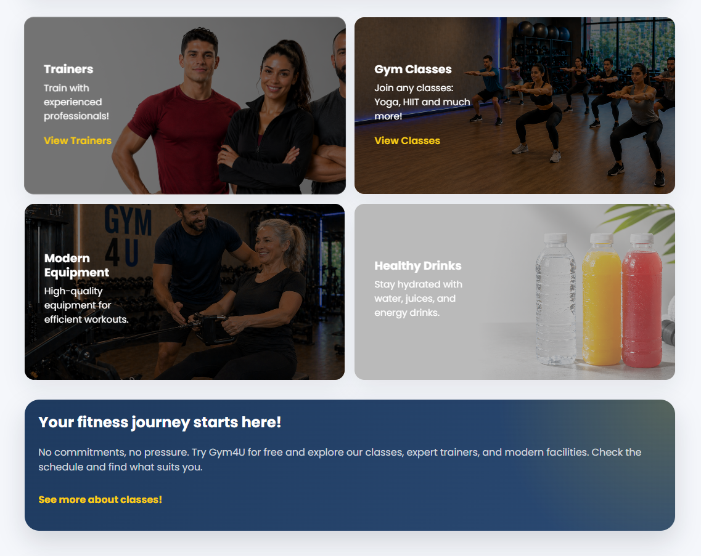
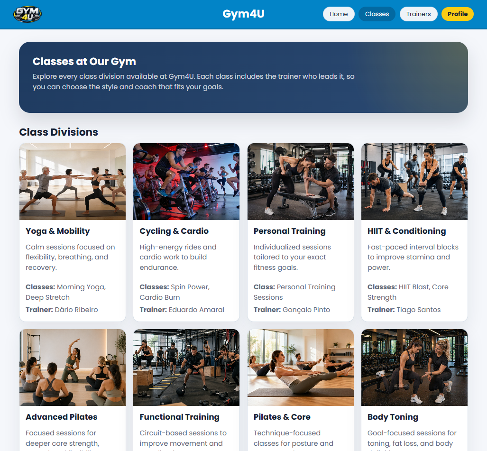
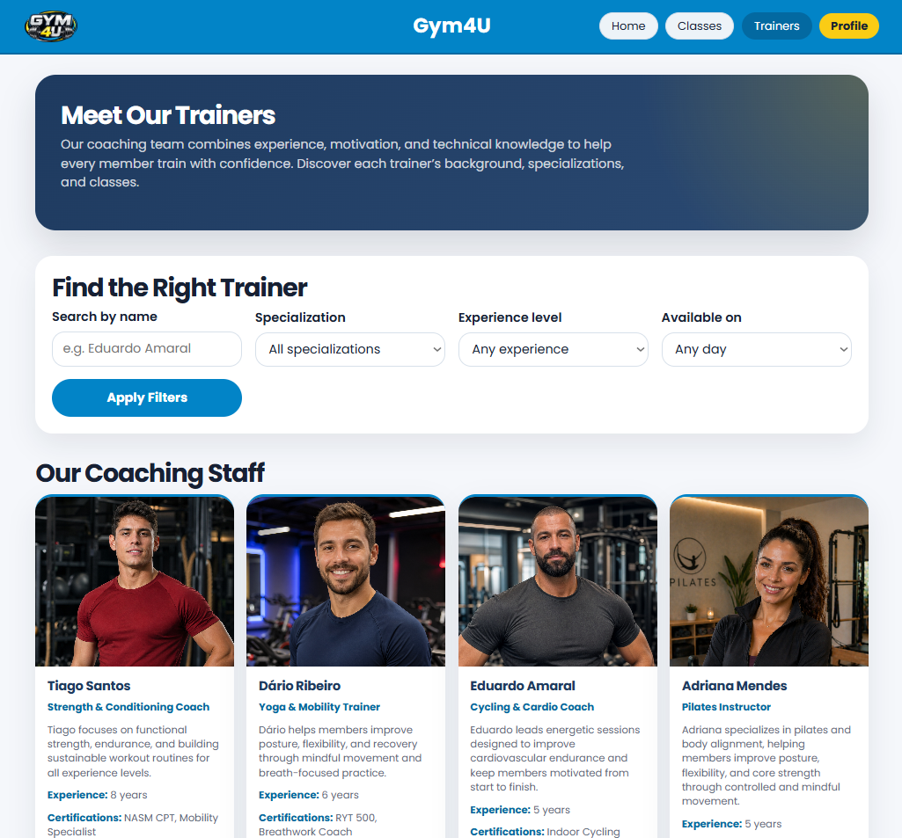

# ltw05g02

# Gym4U

## Project Overview

This project is a gym management website for LTW delivery 1. It presents the core static pages and demonstrates semantic HTML, responsive structure, and organized CSS architecture for a fitness center platform.

## Team

- Dário Amaral - up202405681
- Eduardo Santos - up202406938
- Tiago Ribeiro - up202404941

## Features

**All users:**
- [ ] Register a new account.
- [ ] Log in and out.
- [ ] Edit their profile, including name, username, password, and profile photo.

**Members:**
- [ ] Browse the schedule of available fitness classes, filtering by type, trainer, day, or time.
- [ ] Enroll in and cancel enrollment from upcoming classes, subject to capacity limits.
- [ ] View trainer profiles, including their specializations and the classes they teach.
- [ ] Check the current availability of equipment in the main training area.
- [ ] Leave ratings and reviews for classes they have attended.

**Trainers:**
- [ ] Manage their public profile, including bio, specializations, and certifications.
- [ ] View the roster of members enrolled in their classes.
- [ ] Track and manage their assigned class schedule.

**Admins:**
- [ ] Manage members and trainers (create, update, and deactivate accounts).
- [ ] Manage the class catalog (create, edit, and remove classes) and assign trainers to them.
- [ ] Manage equipment in the main training area (add, update availability status, and remove items).
- [ ] Elevate a user to admin status.
- [ ] Oversee and ensure the smooth operation of the entire system.

**Extra:**
- [ ] Something extra (e.g., personal training bookings, membership plans, waitlist, ...).

## Running

    sqlite3 database/database.db < database/database.sql
    php -S localhost:9000

## Credentials

- admin/p4s5w0rd
- member/1234
- trainer/1234

## First Delivery

This first delivery includes the three selected pages required for evaluation:

1. Home (`index.html`) — landing page with hero slider, feature cards, and a review form.
2. Classes (`classes.html`) — class divisions, weekly schedule table, filter form, enroll/cancel buttons, and a review form.
3. Trainers (`trainers.html`) — trainer profiles with specializations and certifications, filter form, and schedule table.

## Website Screenshots

### Home Page


### Classes Page


### Trainers Page


## Project Structure

```
├── index.html           # Home page
├── classes.html         # Classes page
├── trainers.html        # Trainers page
├── css/                 # CSS files
│   ├── base.css         # CSS reset, typography, and base styles
│   ├── components.css   # Reusable component styles
│   ├── index.css        # Styles that only apply to this page
│   ├── classes.css      # Styles that only apply to this page
│   └── trainers.css     # Styles that only apply to this page
├── images/              # Image assets directory
└── README.md            # Project documentation
```
