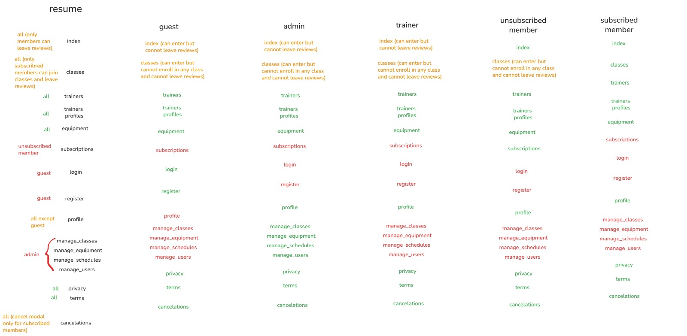
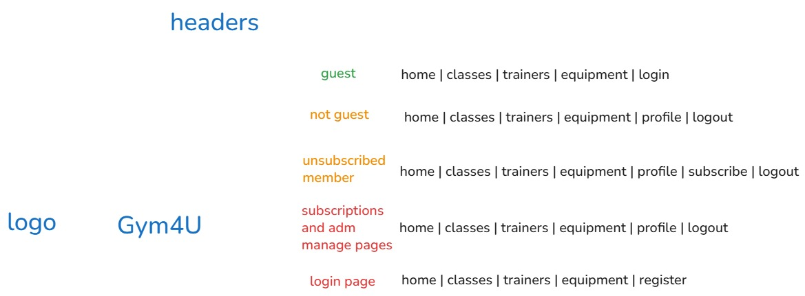

# ltw05g02

# Gym4U

## Project Overview

Gym4U is a gym management website built for the LTW course at FEUP (2026). It allows members to browse and enrol in fitness classes, check equipment availability, and leave reviews. Trainers manage their profile and schedule. Admins control the whole platform.

## Team

- Dário Amaral - up202405681
- Eduardo Santos - up202406938
- Tiago Ribeiro - up202404941

## Features

**All users:**
- [x] Register a new account.
- [x] Log in and out.
- [x] Edit their profile, including name, username, password, and profile photo.

**Members:**
- [x] Browse the schedule of available fitness classes, filtering by type, trainer, day, or time.
- [x] Enroll in and cancel enrollment from upcoming classes, subject to capacity limits.
- [x] View trainer profiles, including their specializations and the classes they teach.
- [x] Check the current availability of equipment in the main training area.
- [x] Leave ratings and reviews for classes they have attended.

**Trainers:**
- [x] Manage their public profile, including bio, specializations, and certifications.
- [x] View the roster of members enrolled in their classes.
- [x] Track and manage their assigned class schedule.

**Admins:**
- [x] Manage members and trainers (create, update, and deactivate accounts).
- [x] Manage the class catalog (create, edit, and remove classes) and assign trainers to them.
- [x] Manage equipment in the main training area (add, update availability status, and remove items).
- [x] Elevate a user to admin status.
- [x] Oversee and ensure the smooth operation of the entire system.

**Extra:**
- [x] **Membership Plans** — three subscription tiers (Off-Peak €19.99, Classic €29.99, Premium €39.99) shown on `subscriptions.php`. Plan stored per user and enforced on enrollment (Off-Peak: up to 2 classes and restricted to classes outside peak hours 18:00–20:00, Classic: up to 6 classes, Premium: unlimited). Members can cancel their membership via `cancellations.php`.
- [x] **Class Waitlist (Premium only)** — when a class is full, Premium members can join a waitlist. When a spot opens (another member cancels), the first person in the queue is automatically enrolled.
- [x] **REST API** — public read-only JSON API under `api/` with endpoints for trainers, equipment, and schedules. Supports filters and returns proper HTTP status codes.
- [x] **Analytics Dashboard** — trainers and admins can view attendance statistics, ratings summaries, and engagement data via `analytics.php`. Gym-wide metrics (most popular classes, enrollment trends, equipment status) available to admins.

## Running

    sqlite3 database/database.db < database/database.sql
    php -S localhost:9000

## Public REST API

The project exposes read-only JSON endpoints for third-party applications:

- `GET /api/index.php` - API discovery with available endpoints and filters.
- `GET /api/schedules.php` - class schedules with class, category, trainer, capacity, enrolled, and available spots.
- `GET /api/trainers.php` - trainer profiles with specializations and taught classes.
- `GET /api/equipment.php` - equipment availability and status.

Supported filters examples:

- `/api/schedules.php?id=1&day=Monday&trainer_id=4&category_id=5&class_id=8&available_only=true`
- `/api/trainers.php?id=1&category_id=4&search=Tiago`
- `/api/equipment.php?id=8&status=available&search=Cable`

## Credentials

| Username | Password | Role | Plan |
|---|---|---|---|
| admin | p4s5w0rd | Admin | — |
| trainer | 1234 | Trainer | — |
| member | 1234 | Member | Premium — use to test waitlist and full membership features |
| member2 | 1234 | Member | Off-Peak — restricted to 2 class enrollments |
| member3 | 1234 | Member | Classic — up to 6 class enrollments |

## Access Control

### Page Access by Role


### Navigation Header by Role


## Website Screenshots

### Home Page


### Classes Page


### Trainers Page


## Project Structure

```
├── index.php                   # Home — hero slider, reviews, review form
├── classes.php                 # Classes — schedule, enroll/cancel, waitlist, reviews
├── trainers.php                # Trainers — list with filter
├── trainer_profile.php         # Trainer detail — bio, schedule, classes
├── equipment.php               # Equipment — availability table with filter
├── profile.php                 # Profile — member/trainer/admin dashboards
├── subscriptions.php           # Membership plan picker (Off-Peak/Classic/Premium)
├── cancellations.php           # Cancellation policy + membership cancel flow
├── login.php / register.php    # Authentication pages
├── privacy.php / terms.php     # Static legal pages
├── manage_users.php            # Admin: CRUD users
├── manage_classes.php          # Admin: CRUD classes
├── manage_schedules.php        # Admin: CRUD class schedules
├── manage_equipment.php        # Admin: CRUD equipment
│
├── controllers/                # Data loaders — query DB, expose vars to views
│   ├── indexController.php
│   ├── classesController.php
│   ├── trainersController.php
│   ├── trainerProfileController.php
│   ├── equipmentController.php
│   ├── profileController.php
│   ├── subscriptionsController.php
│   ├── cancellationsController.php
│   ├── loginController.php
│   ├── registerController.php
│   ├── manage_classes_controller.php
│   ├── manage_schedules_controller.php
│   ├── manage_equipment_controller.php
│   └── manage_users_controller.php
│
├── actions/                    # POST handlers — validate, update DB, redirect
│   ├── login_action.php
│   ├── logout.php
│   ├── register_action.php
│   ├── profile_action.php
│   ├── class_enrollment_action.php
│   ├── review_action.php
│   ├── join_membership_action.php
│   ├── cancel_membership_action.php
│   ├── trainer_profile_action.php
│   ├── trainer_schedule_action.php
│   ├── admin_class_action.php
│   ├── admin_schedule_action.php
│   ├── admin_equipment_action.php
│   └── admin_user_action.php
│
├── ajax/                       # Ajax JSON endpoints — all return JSON
│   ├── enroll.php              # POST — enroll/cancel + auto-enroll from waitlist
│   ├── waitlist.php            # POST — join/leave waitlist (Premium only)
│   ├── classes_filter.php      # GET — filtered schedule with enrollment state
│   ├── review.php              # POST — submit review
│   ├── trainers.php            # GET — filtered trainer list
│   ├── equipment.php           # GET — filtered equipment list
│   ├── manage_classes_filter.php
│   ├── manage_schedules_filter.php
│   ├── manage_equipment_filter.php
│   └── manage_users_filter.php
│
├── api/                        # Public REST API — read-only JSON
│   ├── index.php               # API discovery
│   ├── trainers.php
│   ├── equipment.php
│   ├── schedules.php
│   └── api_helpers.php
│
├── utils/
│   ├── csrf.php                # csrf_token() and csrf_verify()
│   └── membership_limits.php   # Per-plan enrollment limits
│
├── js/
│   ├── main.js                 # Slider, nav enhancements
│   ├── authentication.js       # Password show/hide
│   ├── classes.js              # Enroll/cancel + waitlist Ajax
│   ├── classes_filter.js       # Class table filter + DOM rebuild
│   ├── review.js               # Star rating + review Ajax
│   ├── trainers.js             # Trainer filter Ajax
│   ├── equipment.js            # Equipment filter Ajax
│   ├── manage_classes.js       # Admin class filter Ajax
│   ├── manage_schedules.js     # Admin schedule filter Ajax
│   ├── manage_equipment.js     # Admin equipment filter Ajax
│   └── manage_users.js         # Admin user filter Ajax
│
├── css/
│   ├── base.css                # Reset, typography, CSS variables
│   ├── components.css          # Shared components (buttons, alerts, nav)
│   ├── authentication.css
│   ├── footers.css
│   ├── index.css
│   ├── classes.css
│   ├── trainers.css
│   ├── equipment.css
│   ├── profile.css
│   └── subscriptions.css
│
├── database/
│   ├── database.sql            # Schema + seed data
│   └── db.php                  # PDO connection helper
│
└── images/                     # Static image assets
```
